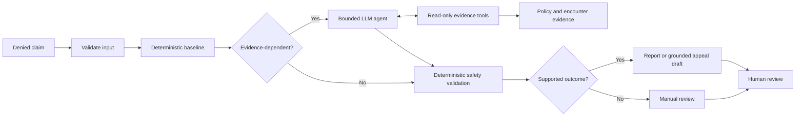

# Claim Denial Triage Agent

A hybrid agentic AI system for evidence-grounded triage of denied outpatient medical claims. The project combines a deterministic Python core with bounded LLM tool use, evidence retrieval, safety validation, and human review.

> **Project status:** Active academic capstone. The deterministic stakeholder baseline and a scripted offline agent-runtime vertical slice are runnable and tested. Production contracts, retrieval tools, safety validators, durable traces, and hosted-model integration remain in progress.

## Problem

Outpatient practices lose recoverable revenue when denied claims are triaged late or incorrectly. A reviewer must determine why a claim was denied, what action is appropriate, what evidence is missing, and whether a filing deadline is still open.

This project is designed to produce a review package for an accounts-receivable specialist. It does **not** submit claims or appeals, connect to a live payer or EHR, or make an autonomous final decision.

## Intended system

The completed system will use a hybrid architecture:



The model will be used only where evidence interpretation is necessary. Exact and safety-critical behavior—including input validation, deadline arithmetic, permitted dispositions, citation checks, and final approval state—remains under deterministic control.

## What is implemented

### Runnable deterministic baseline

The frozen stakeholder baseline currently provides:

- Validation of synthetic professional outpatient claim JSON.
- Mapping for 16 Claim Adjustment Reason Codes (CARCs) and 9 Remittance Advice Remark Codes (RARCs).
- Ten root-cause categories plus explicit unknown/manual-review handling.
- Payer-profile lookup with five illustrative payer profiles and a default fallback.
- Rule-based disposition recommendations and action plans.
- Deterministic filing-deadline calculation.
- Human-readable text reports and structured JSON output.
- Draft appeal letters for findings the baseline classifies as appealable.
- Six labeled synthetic example claims.
- Nine passing unit and regression tests.

The unchanged comparison baseline is preserved under [`baseline/`](baseline/) and tagged as `baseline-v1`.

### Scripted offline agent runtime

The agent package now provides an offline vertical slice for developing and verifying runtime behavior before production integrations are available:

- A provider-independent model interface and deterministic scripted model.
- Strict parsing of permitted structured model actions.
- Explicit runtime phases and controlled state transitions.
- Model-call, tool-call, repair, total-step, and elapsed-time budgets.
- Repeated planning after allowlisted read-only tool observations.
- Budget-limited correction of malformed or validation-rejected output; the
  demonstration permits one attempt.
- Deterministic decision validation through a temporary scripted boundary.
- Append-only in-memory trace entries and explicit terminal reasons.
- Conservative `MANUAL_REVIEW` results when the runtime cannot continue safely.
- A command-line demonstration and an end-to-end integration test using only synthetic data.

This vertical slice establishes runtime control flow; it is not a production claim-review system. Its temporary tool, input, decision, validation, and trace boundaries will be replaced or adapted after issues #3, #5, #6, and #7 deliver the approved shared contracts.

### Remaining project scaffolding

The repository also contains ownership boundaries and placeholders for the remaining system:

- [`src/claim_agent/contracts/`](src/claim_agent/contracts/) — shared data contracts.
- [`src/claim_agent/tools/`](src/claim_agent/tools/) — typed, read-only evidence tools.
- [`src/claim_agent/agent/`](src/claim_agent/agent/) — implemented scripted offline runtime and future production adapters.
- [`src/claim_agent/safety/`](src/claim_agent/safety/) — deterministic validation and approval gates.
- [`src/claim_agent/output/`](src/claim_agent/output/) — review reports and appeal preparation.
- [`knowledge/`](knowledge/) — versioned policies and synthetic evidence.
- [`datasets/`](datasets/) — development, held-out, and labeling artifacts.
- [`evaluation/`](evaluation/) — metrics, fault injection, and comparison harnesses.

Directories other than the implemented baseline and scripted agent runtime remain scaffolding unless explicitly documented otherwise.

## Safety boundaries

- Only synthetic data is used. No protected health information is included.
- The system will not submit a claim, appeal, or patient bill.
- Every report begins in a human-review state.
- Missing, conflicting, unsupported, or unavailable evidence must lead to manual review.
- Retrieved policy and clinical text is treated as untrusted data, not as instructions.
- Illustrative payer rules must not be interpreted as verified contract terms.

## Requirements

The baseline and scripted offline runtime require:

- Python 3.9 or newer.
- No third-party packages.
- No model API key.
- No network connection.

Future production integrations may introduce separate dependencies. Those dependencies will not be added to the frozen baseline.

## Setup

Clone the repository and enter its root directory:

```bash
git clone <repository-url>
cd claim-denial-triage-agent
```

Confirm Python is available:

```bash
python --version
```

On Windows, the Python launcher may be used instead:

```powershell
py -3 --version
```

No installation step is required to run the baseline.

## Run the baseline tests

From the repository root:

```bash
python -m unittest discover -s baseline/tests -p "test*.py" -v
```

On Windows, replace `python` with `py -3` if needed:

```powershell
py -3 -m unittest discover -s '.\baseline\tests' -p 'test*.py' -v
```

Expected result:

```text
Ran 9 tests
OK
```

## Run the offline agent tests

The agent runtime uses a `src` layout. From the repository root, expose that directory to Python and run the component and integration suites:

```bash
PYTHONPATH=src python -m unittest discover -s tests/agent -p "test*.py" -q
PYTHONPATH=src python -m unittest discover -s tests/integration -p "test*.py" -q
```

In PowerShell:

```powershell
$env:PYTHONPATH = '.\src'
python -m unittest discover -s '.\tests\agent' -p 'test*.py' -q
python -m unittest discover -s '.\tests\integration' -p 'test*.py' -q
```

These tests use scripted model, tool, and validation boundaries. They do not require network access or model credentials.

## Run the offline agent demonstration

The demonstration runs a synthetic medical-necessity denial through policy retrieval, evidence-context updating, decision proposal, deterministic validation, and trace emission:

```bash
PYTHONPATH=src python -m claim_agent.agent.offline_runner --pretty
```

In PowerShell:

```powershell
$env:PYTHONPATH = '.\src'
python -m claim_agent.agent.offline_runner --pretty
```

The JSON output reports the terminal phase, reason, accepted decision, consumed budgets, and ordered trace-event names. All model, tool, and validation responses in this demonstration are predefined fixtures rather than production services.

## Run one reproducible example

The following case is a synthetic brain MRI claim with a medical-necessity denial. The fixed `--as-of` date makes its deadline calculation reproducible.

```bash
python baseline/run_baseline.py \
  --input baseline/examples/test2_medical_necessity.json \
  --as-of 2026-09-06 \
  --outdir .local-output/baseline-smoke
```

PowerShell equivalent:

```powershell
py -3 '.\baseline\run_baseline.py' `
    --input '.\baseline\examples\test2_medical_necessity.json' `
    --as-of '2026-09-06' `
    --outdir '.\.local-output\baseline-smoke'
```

The expected primary result is:

```text
Disposition: APPEAL_WITH_DOCUMENTATION
Root cause: MEDICAL_NECESSITY
Deadline: 2027-01-07
```

The command writes a readable report and a structured JSON record to the selected output directory.

## Run all baseline examples

```bash
python baseline/run_baseline.py \
  --input baseline/examples \
  --as-of 2026-09-06 \
  --outdir .local-output/baseline-all \
  --quiet
```

This processes the six labeled example claims. Generated local outputs are ignored by Git.

## Baseline limitations

The baseline is intentionally narrow. It cannot retrieve or interpret payer medical policies, read clinical notes, resolve nuanced evidence conflicts, or adaptively request missing documents. Its filing windows are illustrative, its code mapping is a working subset, and its labels are a small synthetic development set.

These limitations define the work assigned to the agentic extension; they are not claims of real-world clinical or billing performance.

## Planned agentic extension

- [ ] Freeze shared claim, evidence, tool, decision, and trace contracts.
- [ ] Wrap deterministic baseline behavior behind stable interfaces.
- [ ] Implement a validated common tool dispatcher.
- [ ] Add versioned payer-policy, encounter-note, and eligibility retrieval.
- [x] Implement a bounded planning loop with structured model outputs behind scripted offline boundaries.
- [ ] Replace scripted runtime boundaries with approved production adapters.
- [ ] Add criterion-level evidence assessment and resolvable citations.
- [ ] Add deterministic safety and deadline verification.
- [ ] Generate appeal drafts only from verified evidence.
- [ ] Build development and held-out synthetic datasets.
- [ ] Compare the agentic system against the unchanged baseline.
- [ ] Conduct stakeholder review of representative system reports.

The primary evaluation will compare joint root-cause/disposition accuracy, selective accuracy, resolution coverage, citation precision, unsupported assertions, consistency, latency, cost, and critical safety failures.

## Repository structure

```text
baseline/                 Frozen deterministic comparison system
datasets/                 Development, held-out, and label artifacts
docs/reference/           Stakeholder proposal and project milestone
docs/decisions/           Architecture decision records
evaluation/               Evaluation and fault-injection harnesses
knowledge/                Versioned policy and synthetic evidence corpus
src/claim_agent/agent/    Bounded LLM orchestration
src/claim_agent/contracts Shared schemas and enums
src/claim_agent/output/   Reports and appeal preparation
src/claim_agent/safety/   Deterministic validation and human-review gates
src/claim_agent/tools/    Typed read-only tools and dispatcher
tests/                    Agentic-system tests organized by component
```

## Development guide

Team ownership, integration contracts, branch conventions, review responsibilities, and the phased implementation plan are documented in [the team development guide](docs/TEAM_DEVELOPMENT_GUIDE.md).

Every pull request must either update the relevant documentation or state why no documentation change is needed. Update this README when setup, commands, capabilities, limitations, architecture, layout, status, or roadmap claims change. Update the team guide when ownership, interfaces, dependencies, evaluation procedures, or collaboration rules change. After merge, the pull-request author verifies both documents against the new `main`; missed updates are fixed through a follow-up documentation pull request, never by pushing directly to protected `main`.

## Team

- Neha Kashyap
- Hriday Pradhan
- Silas Sangmin
- Sachin Kothandaraman

Developed as a CSE 598 Agentic AI capstone project at Arizona State University.

## Disclaimer

This repository is an educational prototype. It is not medical, legal, financial, coding, reimbursement, or payer-contract advice and must not be used to process real patient claims.
