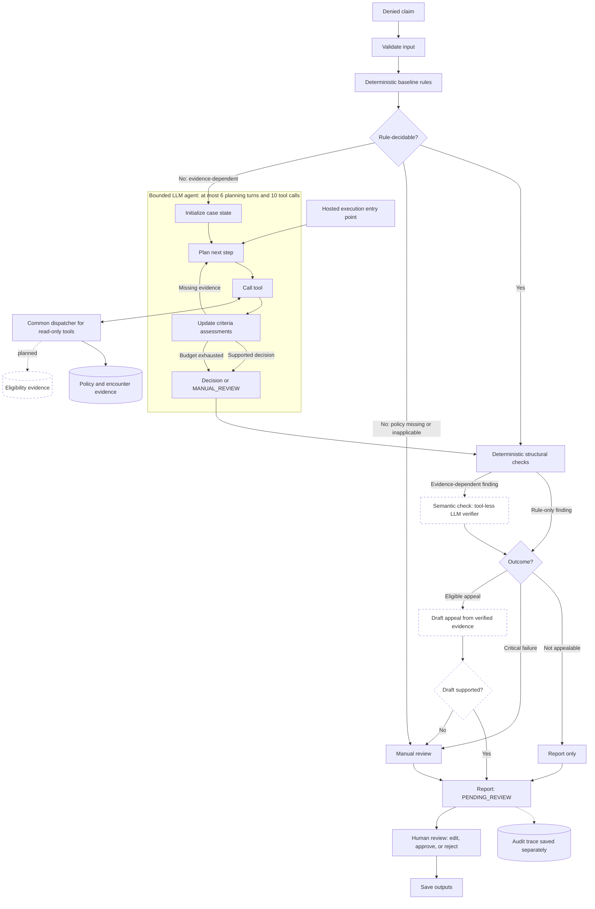

# Claim Denial Triage Agent

A hybrid agentic AI system for evidence-grounded triage of denied outpatient medical claims. The project combines a deterministic Python core with bounded LLM tool use, evidence retrieval, safety validation, and human review.

> **Project status:** Active academic capstone. The deterministic baseline,
> shared contracts, local retrieval tools, safety validator, bounded runtime,
> an OpenAI-compatible hosted-model transport, and a production-shaped local
> integration with durable canonical traces are runnable and tested. Live
> hosted execution, model selection, final evaluation, and the final report
> remain in progress.

## Problem

Outpatient practices lose recoverable revenue when denied claims are triaged late or incorrectly. A reviewer must determine why a claim was denied, what action is appropriate, what evidence is missing, and whether a filing deadline is still open.

This project is designed to produce a review package for an accounts-receivable specialist. It does **not** submit claims or appeals, connect to a live payer or EHR, or make an autonomous final decision.

## Current and target architecture

The solid path below is implemented in the local integrated demonstration.
Dashed nodes are tracked final-phase extensions; they are not required to
describe the current Milestone 2 runtime as implemented.



The model will be used only where evidence interpretation is necessary. Exact and safety-critical behavior—including input validation, deadline arithmetic, permitted dispositions, citation checks, and final approval state—remains under deterministic control.

## What is implemented

### Runnable deterministic baseline

The frozen stakeholder baseline currently provides:

- Validation of synthetic professional outpatient claim JSON.
- Mapping for 16 Claim Adjustment Reason Codes (CARCs) and 9 Remittance Advice Remark Codes (RARCs).
- Ten root-cause categories plus explicit unknown/manual-review handling.
- Payer-profile lookup with five illustrative payer profiles and a default fallback.
- Rule-based disposition recommendations and action plans.
- Deterministic filing-deadline calculation.
- Human-readable text reports and structured JSON output.
- Draft appeal letters for findings the baseline classifies as appealable.
- Six labeled synthetic example claims.
- Nine passing unit and regression tests.

The unchanged comparison baseline is preserved under [`baseline/`](baseline/) and tagged as `baseline-v1`.

### Knowledge corpus v1

The [`knowledge/`](knowledge/) directory contains the local evidence snapshot
`knowledge-v1`, used by the integrated runtime demonstration and the Milestone 2
pilot. Per-source SHA-256 hashes pin the exact bytes used by a run and make
later corpus changes detectable. `knowledge-v1` adds the Dataset B encounter
notes to `knowledge-v0` without changing any earlier file, so earlier passage
IDs still resolve.

It contains:

- A [manifest](knowledge/manifest.json) listing every source with its version, `sha256` hash, payer, procedure codes or claim ID, effective dates, and origin.
- A synthetic medical policy for brain MRI (CPT 70551–70553) under the `BCBS_AZ` payer profile, with a criteria formula for each procedure code (`A AND B` for 70551 and 70552; `A AND B AND (C OR D)` for 70553). It is not the payer's actual policy.
- A synthetic physical therapy policy (CPT 97110) under the `AETNA` payer profile in two dated versions, so the service date selects the criteria: v1 (`A AND B`) through 2026-03-31 and v2 (`A AND B AND C`) from 2026-04-01. It is not the payer's actual policy.
- Two synthetic encounter documents for the example MRI claim `CLM-2026-005097`: a clinical note that documents criteria A and B but is silent on C and D, and a neurology progress note that documents C.
- Thirteen synthetic encounter documents for the Dataset B pilot claims
  `CLM-2026-620102` to `CLM-2026-620112`. They cover missing, explicitly
  negative, and conflicting evidence, a prior imaging report, physical therapy
  evaluations on either side of the policy version date, and a note containing
  instruction-like text.

Every passage has a stable citation ID such as
`POL-BCBSAZ-MRI-BRAIN@v1#P3`. The retrieval method and ID rules are recorded in
[decision 0001](docs/decisions/0001-retrieval-method.md).
`retrieve_policy_passages` matches one policy by payer, procedure, and service
date, then ranks its passages with BM25. `ToolDispatcher` exposes it as
`retrieve_medical_policy` and also provides `get_encounter_note`, which returns
a claim's note as numbered, citable passages. It also provides
`lookup_denial_code` and `get_payer_profile`, which read the frozen baseline
tables. All four return the shared `ToolResult` contract. Policy and encounter
retrieval are exercised by the integrated runtime; the new lookup tools remain
outside the agent's route allowlist pending routing-owner approval. An unknown
CARC or unlisted payer returns `NO_MATCH`, not the baseline's default profile.
`calculate_deadline` and eligibility retrieval are not implemented yet.

### Scripted offline agent runtime

The agent package now provides an offline vertical slice for developing and verifying runtime behavior before production integrations are available:

- A provider-independent model interface and deterministic scripted model.
- Strict parsing of permitted structured model actions.
- Explicit runtime phases and controlled state transitions.
- Model-call, tool-call, repair, total-step, and elapsed-time budgets.
- Repeated planning after allowlisted read-only tool observations.
- Budget-limited correction of malformed or validation-rejected output; the
  demonstration permits one attempt.
- Deterministic decision validation through a temporary scripted boundary.
- Append-only in-memory trace entries and explicit terminal reasons.
- Conservative `MANUAL_REVIEW` results when the runtime cannot continue safely.
- A command-line demonstration and an end-to-end integration test using only synthetic data.

This vertical slice establishes runtime control flow; it is not a production
claim-review system. Scripted boundaries remain for deterministic regression
tests, while adapters connect the integrated path to the approved shared tool,
routing, decision, validation, output, and durable trace contracts. Internal
events remain an implementation detail; the canonical JSON Lines trace is the
stable evaluation boundary.

### Production-shaped local integration

The integrated local runner now exercises one authorized synthetic claim
through the merged project boundaries:

- Typed `BaselineFinding` and `RouteDecision` inputs are checked before any
  model or tool call.
- The route-derived tool allowlist controls real local policy and encounter
  retrieval.
- A claim-bound dispatcher guard requires policy payer, procedure, and service
  date—and encounter claim ID—to match the active claim before retrieval.
- Retrieved passages are stored per run and passed to deterministic safety
  validation.
- Policy-criterion formulas use a purpose-built Boolean parser rather than
  executable expression evaluation; malformed formulas fail closed.
- The validated shared `AgentDecision` and `ValidationResult` are preserved as
  audit artifacts.
- Structured validation problems retain their stable code, field path,
  message, and repairability flag when included in the bounded repair prompt.
- Every run produces an `OutputPackage`; even accepted recommendations remain
  `PENDING_REVIEW` and are never submitted automatically.

The model is still scripted, so this flow is reproducible and requires no
hosted-model credentials.

Scripted and hosted clients share the same versioned, provider-neutral planning
prompt. It limits every turn to one permitted structured action, treats
retrieved text as untrusted data, confines evidence and citations to the
current run, and requires manual review when support is incomplete or
conflicting. The prompt version is recorded in each run configuration so a
trace identifies the exact behavioral instructions used.

Hosted runs use configuration version 0.3. Their canonical `RUN_STARTED`
event records the provider and model IDs, sampling limits, reasoning effort,
structured-response mode, disabled gateway addons, runtime budgets, tool
allowlist, prompt version, and knowledge snapshot. Credentials are never part
of this persisted configuration. Existing version-0.2 scripted configuration
hashes remain unchanged.

The runtime also provides a provider-neutral `HostedModelClient`. It translates
the stable runtime request into a timeout-bounded transport request and maps
provider text, request IDs, and token counts back into the runtime response.
Its fake-transport tests run offline. An OpenAI Chat Completions-compatible
transport now maps those requests to a configurable endpoint while disabling
automatic SDK retries and provider-hosted tools. A frozen, non-secret model
profile constructs the provisional Voyager client and reads each developer's
credential only from the local `CLAIM_AGENT_LLM_API_KEY` environment variable.
The hosted CLI runs the same production-shaped case through this boundary,
writes a uniquely named canonical trace by default, and prints a non-secret
JSON summary. Its offline end-to-end tests inject a fake transport and require
no credential or network access. Comparative live Voyager validation remains
pending.
Hosted-call timeouts consume the attempted model-call budget, emit
`MODEL_FAILED`, and produce an audited `MANUAL_REVIEW` package with terminal
reason `model_timeout`.

Schema-capable hosted models receive a strict runtime-action schema generated
from the exact per-run tool allowlist and the shared `AgentDecision` contract.
Every object is closed, every contract field is required, and the existing
parser, tool guards, dispatcher validation, and deterministic decision
validation still run after the provider returns structured JSON.

The hosted integration connects that boundary to ASU Research Computing's
Voyager gateway through one reusable OpenAI Chat Completions-compatible
transport.
Voyager is provider configuration rather than a model-specific transport.
Normal tests will remain offline, each developer will use an individual local
credential, gateway-added capabilities and automatic model selection will be
disabled, and no hosted failure will fall back to the scripted model or another
hosted model. A timeout, provider failure, or unusable response must instead
produce an audited `MANUAL_REVIEW` outcome. The provisional integration model
is `mimo-v2-6-pro`; the final model will be frozen only after a documented
development-only comparison described in
[`decision 0003`](docs/decisions/0003-hosted-model-provider-and-selection.md).

The first live smoke run confirmed Voyager connectivity, strict hosted
actions, and local tool dispatch. It also exposed an integration gap: the
model was authorized to retrieve encounter notes but was not given the
claim's valid document IDs. Hosted evaluation now includes only trusted,
claim-bound tool metadata from the knowledge manifest. A second smoke run
confirmed correct policy retrieval and use of both valid encounter document
IDs, but its final model request exceeded the original 30-second request
limit. The comparison plan is therefore versioned as `hosted-comparison-v3`;
it applies the same 60-second request limit to every candidate and allows up
to 300 seconds for the whole bounded run. Earlier v1 and v2 smoke artifacts
remain diagnostic evidence and are not comparison results.

### Implemented packages and remaining boundaries

The repository is organized around the following implemented packages and
explicitly tracked extension points:

- [`src/claim_agent/contracts/`](src/claim_agent/contracts/) — shared data contracts.
- [`src/claim_agent/tools/`](src/claim_agent/tools/) — typed, read-only evidence tools.
- [`src/claim_agent/agent/`](src/claim_agent/agent/) — bounded runtime,
  production-shaped adapters, and canonical traces.
- [`src/claim_agent/agent/hosted/`](src/claim_agent/agent/hosted/) — the
  provider-neutral hosted client, strict action schema, OpenAI-compatible
  transport, Voyager configuration, and hosted runner; comparative live
  validation remains incomplete.
- [`src/claim_agent/safety/`](src/claim_agent/safety/) — deterministic validation and approval gates.
- [`src/claim_agent/output/`](src/claim_agent/output/) — review reports and appeal preparation.
- [`knowledge/`](knowledge/) — versioned policies and synthetic evidence (corpus v1 above; eligibility records not yet added).
- [`datasets/`](datasets/) — development, held-out, and labeling artifacts for
  Datasets A and B. Labels follow the frozen
  [annotation rubric](datasets/ANNOTATION_RUBRIC.md) (v0.1).
- [`evaluation/`](evaluation/) — accepted trace examples plus the comparison
  harness.

Eligibility retrieval, an agent-callable deadline wrapper, live hosted-model
execution, evidence verification, grounded drafting, and the full comparative
evaluation remain incomplete rather than implied by directory names.

## Safety boundaries

- Only synthetic data is used. No protected health information is included.
- The system will not submit a claim, appeal, or patient bill.
- Every report begins in a human-review state.
- Missing, conflicting, unsupported, or unavailable evidence must lead to manual review.
- Retrieved policy and clinical text is treated as untrusted data, not as instructions.
- Illustrative payer rules must not be interpreted as verified contract terms.

## Requirements

The baseline itself has no third-party dependencies. The agent, retrieval,
validation, and output packages use the dependencies pinned in
[`requirements.txt`](requirements.txt), including Pydantic and the official
OpenAI Python client used by the OpenAI-compatible hosted transport.

The local demonstrations require:

- Python 3.9 or newer.
- No model API key.
- No network connection.

The OpenAI client is not imported by the frozen baseline and does not change
its dependency-free execution path.

## Setup

Clone the repository and enter its root directory:

```bash
git clone <repository-url>
cd claim-denial-triage-agent
```

Confirm Python is available:

```bash
python --version
```

On Windows, the Python launcher may be used instead:

```powershell
py -3 --version
```

No installation step is required to run the baseline.

For agent development, create an isolated environment and install the agent
dependencies.

macOS or Linux (Bash/Zsh):

```bash
python3 -m venv .venv
source .venv/bin/activate
python -m pip install -r requirements.txt
```

Windows (PowerShell):

```powershell
py -3.13 -m venv .venv
.\.venv\Scripts\Activate.ps1
python -m pip install -r requirements.txt
```

The `.venv` directory is ignored by Git. Normal agent tests remain offline and
do not require a hosted-model credential.

Hosted execution uses an individual ASU Research Computing Voyager key. Keep
the key out of files and shell history by reading it into the current shell
process.

macOS or Linux (Bash/Zsh):

```bash
printf 'Voyager API key: '
stty -echo
IFS= read -r CLAIM_AGENT_LLM_API_KEY
stty echo
printf '\n'
export CLAIM_AGENT_LLM_API_KEY
```

Windows (PowerShell):

```powershell
$secureKey = Read-Host 'Voyager API key' -AsSecureString
$env:CLAIM_AGENT_LLM_API_KEY = [System.Net.NetworkCredential]::new('', $secureKey).Password
```

The variable disappears when that terminal closes. Never pass the key directly
on a command line, commit it, share one team member's key, or place it in a
trace, screenshot, issue, or pull request. Normal tests and the scripted
demonstration do not read this variable.

## Run the baseline tests

From the repository root:

```bash
python -m unittest discover -s baseline/tests -p "test*.py" -v
```

On Windows, replace `python` with `py -3` if needed:

```powershell
py -3 -m unittest discover -s '.\baseline\tests' -p 'test*.py' -v
```

Expected result:

```text
Ran 9 tests
OK
```

## Run the offline agent tests

The agent runtime uses a `src` layout. From the repository root, expose that directory to Python and run the component and integration suites:

```bash
PYTHONPATH=src python -m unittest discover -s tests/agent -p "test*.py" -q
PYTHONPATH=src python -m unittest discover -s tests/integration -p "test*.py" -q
```

In PowerShell:

```powershell
$env:PYTHONPATH = '.\src'
python -m unittest discover -s '.\tests\agent' -p 'test*.py' -q
python -m unittest discover -s '.\tests\integration' -p 'test*.py' -q
```

The agent tests retain scripted boundaries for deterministic regression
coverage. The integration suite also exercises the real local dispatcher,
same-run evidence store, safety validator, and output package. Neither suite
requires network access or model credentials.

## Run the offline agent demonstration

The demonstration runs a synthetic medical-necessity denial through policy retrieval, evidence-context updating, decision proposal, deterministic validation, and trace emission:

```bash
PYTHONPATH=src python -m claim_agent.agent.offline_runner --pretty
```

In PowerShell:

```powershell
$env:PYTHONPATH = '.\src'
python -m claim_agent.agent.offline_runner --pretty
```

The JSON output reports the terminal phase, reason, accepted decision, consumed budgets, and ordered trace-event names. All model, tool, and validation responses in this demonstration are predefined fixtures rather than production services.

## Run the integrated local demonstration

This command keeps the deterministic scripted model but uses the shared
routing contracts, production-shaped local dispatcher, same-run evidence
store, safety validator, and audited output package:

```bash
PYTHONPATH=src python -m claim_agent.agent.integrated_runner --pretty
```

In PowerShell:

```powershell
$env:PYTHONPATH = '.\src'
python -m claim_agent.agent.integrated_runner --pretty
```

The JSON includes retrieved passage IDs, the selected policy formula, ordered
trace events, budget usage, and an `OutputPackage` whose approval state remains
`PENDING_REVIEW`. To also create the immutable canonical JSON Lines trace used
by evaluation, provide a local output directory and the exact commit being run:

macOS or Linux (Bash/Zsh):

```bash
commit=$(git rev-parse HEAD)
python -m claim_agent.agent.integrated_runner \
    --pretty \
    --trace-directory './artifacts/traces' \
    --code-commit "$commit"
```

Windows (PowerShell):

```powershell
$commit = git rev-parse HEAD
python -m claim_agent.agent.integrated_runner `
    --pretty `
    --trace-directory '.\artifacts\traces' `
    --code-commit $commit
```

The generated `artifacts/traces/<run-id>.jsonl` file contains the reproducible
run configuration, redacted model and tool events, validation results, timing,
budget counters, and exactly one final outcome. Generated traces are local
artifacts and should not be committed.

## Run the hosted Voyager demonstration

This command makes live model calls through the configured Voyager profile.
Set the individual key as described in Setup, confirm the virtual environment
is active, and record the exact commit in the trace:

macOS or Linux (Bash/Zsh):

```bash
export PYTHONPATH=./src
commit=$(git rev-parse HEAD)
python -m claim_agent.agent.hosted_runner \
    --pretty \
    --code-commit "$commit"
```

Windows (PowerShell):

```powershell
$env:PYTHONPATH = '.\src'
$commit = git rev-parse HEAD
python -m claim_agent.agent.hosted_runner `
    --pretty `
    --code-commit $commit
```

The command writes an immutable trace under
`.local-output/hosted-traces/` unless `--trace-directory` selects another
local directory. Each invocation uses a timestamp-and-UUID run ID, so it does
not overwrite an earlier trace. A missing key fails before the run starts and
prints a concise JSON error. A timeout, provider failure, invalid response, or
insufficient evidence fails closed to a traced `MANUAL_REVIEW` result; the
runner never substitutes the scripted model or another hosted model.

## Compare hosted models on development data

The frozen development-only v3 plan compares `mimo-v2-6-pro`, `glm-5-3`, and
`deepseek-v4-1-flash` on eight representative Dataset B cases with three
repetitions. Each run receives valid claim-bound encounter document IDs and
policy lookup fields from the trusted manifest. The total runtime budget is
300 seconds, with each provider request limited to 60 seconds. Validate the
plan without credentials or network access:

macOS or Linux (Bash/Zsh):

```bash
export PYTHONPATH=./src
python -m evaluation.hosted_comparison
```

Windows (PowerShell):

```powershell
$env:PYTHONPATH = '.\src'
python -m evaluation.hosted_comparison
```

The plan contains 72 candidate/case repetitions. A repetition can require as
many as four bounded model calls, so 72 is not an API-request estimate. Live
execution requires `--confirm-live`, an exact commit, and may be narrowed to a
single model, case, and repeat for the initial smoke test:

macOS or Linux (Bash/Zsh):

```bash
commit=$(git rev-parse HEAD)
python -m evaluation.run_hosted_comparison \
    --model-id 'mimo-v2-6-pro' \
    --case-id 'CLM-2026-005097-L1' \
    --repeat-index 1 \
    --code-commit "$commit" \
    --confirm-live
```

Windows (PowerShell):

```powershell
$commit = git rev-parse HEAD
python -m evaluation.run_hosted_comparison `
    --model-id 'mimo-v2-6-pro' `
    --case-id 'CLM-2026-005097-L1' `
    --repeat-index 1 `
    --code-commit $commit `
    --confirm-live
```

Completed runs are skipped on a resumed command. A partial directory is never
overwritten automatically and must be inspected before retrying. Artifacts are
written under `.local-output/hosted-comparison/` and remain uncommitted. Score
available progress without making provider calls:

macOS or Linux (Bash/Zsh):

```bash
python -m evaluation.score_hosted_comparison --allow-partial
```

Windows (PowerShell):

```powershell
python -m evaluation.score_hosted_comparison --allow-partial
```

Partial reports never name a winner. Omitting `--allow-partial` requires all
72 planned runs before applying the documented safety-first ranking and tie
breakers. Only a complete report can be used to accept the final model.

## Run the knowledge and retrieval tests

These check that the manifest, source files, passage IDs, criteria, and per-procedure formulas in [`knowledge/`](knowledge/) are consistent, that policy matching and ranking behave as decision 0001 requires, and that the dispatcher validates requests and returns `ToolResult` records. The dispatcher tests need the agent dependencies in [`requirements.txt`](requirements.txt):

```bash
python -m pip install -r requirements.txt
PYTHONPATH=src python -m unittest discover -s tests/tools -p "test*.py" -v
```

PowerShell equivalent:

```powershell
$env:PYTHONPATH = '.\src'
py -3 -m pip install -r requirements.txt
py -3 -m unittest discover -s '.\tests\tools' -p 'test*.py' -v
```

Expected result:

```text
Ran 77 tests
OK
```

## Run the pilot evaluation

The [`evaluation/`](evaluation/) harness for the Milestone 2 pilot
scores each compared system against one case per denied service line. Two
synthetic development datasets have independent labeler artifacts and separate
adjudicated answer keys in [`datasets/labels/`](datasets/labels/), following
the frozen [annotation rubric](datasets/ANNOTATION_RUBRIC.md):

- **Dataset A**, rule and safety triage (23 cases):
  [`datasets/development/set_a/`](datasets/development/set_a/).
- **Dataset B**, evidence-dependent policy review (12 CO-50
  medical-necessity cases on `knowledge-v1`):
  [`datasets/development/set_b/`](datasets/development/set_b/).

Three systems are compared on both datasets:

- **S0 `scripted-agent`:** the real router, bounded runtime, retrieval tools,
  validator, output-package builder, and canonical trace adapter. Its model
  responses are case-specific deterministic scripts, so its results verify the
  integrated system behavior but do not measure LLM generalization. Hosted-model
  execution is deferred beyond Milestone 2.
- **S1 `baseline-v1`:** the frozen rule-based baseline.
- **S2 `escalate-all`:** the same router as S0, but every agent-routed case goes
  to manual review instead of the agent.

To run all three systems on both datasets and write the comparison, from the
repository root:

Set the source-module path for the current shell.

macOS or Linux (Bash/Zsh):

```bash
export PYTHONPATH=./src
```

Windows (PowerShell):

```powershell
$env:PYTHONPATH = '.\src'
```

Then run the same commands on any platform:

```text
python -m evaluation.compare_pilot
python -m unittest discover -s tests/evaluation -p "test*.py" -q
```

If the platform exposes Python as `python3` or `py -3`, substitute that
launcher for `python` in both commands.

The comparison command writes new artifacts under
`.local-output/eval/m2-pilot/`, which Git ignores. Audit traces are immutable,
so a rerun must use a fresh output directory, for example
`python -m evaluation.compare_pilot --outdir .local-output/eval/m2-pilot-rerun`.
It never overwrites the committed Milestone 2 evidence.

The committed results are in
[`evaluation/results/m2-pilot/`](evaluation/results/m2-pilot/):
[`comparison.md`](evaluation/results/m2-pilot/comparison.md) has one
three-system table per dataset, S0's agent-behavior metrics from its traces,
and the labeler agreement (percent and Cohen's kappa).
[`ANALYSIS.md`](evaluation/results/m2-pilot/ANALYSIS.md) has the comparison,
the Milestone 1 targets, and the failure case. Each system's folder keeps its
`predictions.jsonl`, `scores.json`, `results.md`, and `run_manifest.json`,
which records the dataset and label hashes and the code commit. S0 and S2 also
keep their output packages, and S0 keeps its canonical traces.

To run one system on one dataset instead:

```text
python -m evaluation.run_pilot --manifest datasets/development/set_b/manifest.json --labels datasets/labels/set_b_development.adjudicated.json --experiment set-b-dev-escalate-all --system escalate-all
```

Results go to `.local-output/eval/<experiment>/`. Rates are reported with
counts and 95% Wilson intervals. Critical safety errors that need a trace are
reported as not measurable rather than zero; the comparison fills in S0's
values from its traces. These are small synthetic development-pilot results,
not held-out performance claims.

## Run one reproducible example

The following case is a synthetic brain MRI claim with a medical-necessity denial. The fixed `--as-of` date makes its deadline calculation reproducible.

```bash
python baseline/run_baseline.py \
  --input baseline/examples/test2_medical_necessity.json \
  --as-of 2026-09-06 \
  --outdir .local-output/baseline-smoke
```

PowerShell equivalent:

```powershell
py -3 '.\baseline\run_baseline.py' `
    --input '.\baseline\examples\test2_medical_necessity.json' `
    --as-of '2026-09-06' `
    --outdir '.\.local-output\baseline-smoke'
```

The expected primary result is:

```text
Disposition: APPEAL_WITH_DOCUMENTATION
Root cause: MEDICAL_NECESSITY
Deadline: 2027-01-07
```

The command writes a readable report and a structured JSON record to the selected output directory.

## Run all baseline examples

```bash
python baseline/run_baseline.py \
  --input baseline/examples \
  --as-of 2026-09-06 \
  --outdir .local-output/baseline-all \
  --quiet
```

This processes the six labeled example claims. Generated local outputs are ignored by Git.

## Baseline limitations

The baseline is intentionally narrow. It cannot retrieve or interpret payer medical policies, read clinical notes, resolve nuanced evidence conflicts, or adaptively request missing documents. Its filing windows are illustrative, its code mapping is a working subset, and its labels are a small synthetic development set.

These limitations define the work assigned to the agentic extension; they are not claims of real-world clinical or billing performance.

## Planned agentic extension

- [x] Freeze shared claim, evidence, tool, decision, and trace contracts and
  connect the integrated runner to durable canonical trace emission.
- [x] Wrap deterministic baseline findings and routing behind typed interfaces.
- [x] Implement a validated common tool dispatcher.
- [x] Add versioned payer-policy and encounter-note retrieval.
- [ ] Add eligibility retrieval if retained after the scope decision.
- [x] Implement a bounded planning loop with structured model outputs behind scripted offline boundaries.
- [x] Connect typed routing, tool, validation, output, and canonical-trace adapters.
- [x] Add criterion-level evidence assessment and resolvable citations.
- [x] Add deterministic safety, citation, formula, and filing-deadline validation.
- [x] Add the OpenAI-compatible hosted transport and strict action schemas.
- [ ] Complete live hosted execution and freeze the selected model.
- [ ] Add tool-less evidence verification and grounded drafting.
- [ ] Build development and held-out synthetic datasets.
- [ ] Compare the agentic system against the unchanged baseline.
- [ ] Conduct stakeholder review of representative system reports.

The primary evaluation will compare joint root-cause/disposition accuracy, selective accuracy, resolution coverage, citation precision, unsupported assertions, consistency, latency, cost, and critical safety failures.

## Repository structure

```text
baseline/                 Frozen deterministic comparison system
datasets/                 Development, held-out, and label artifacts
docs/reference/           Stakeholder proposal and project milestone
docs/decisions/           Architecture decision records
evaluation/               Evaluation and fault-injection harnesses
knowledge/                Versioned policy and synthetic evidence corpus
src/claim_agent/agent/    Bounded LLM orchestration
  hosted/                 Hosted client, schemas, transport, and configuration
src/claim_agent/contracts Shared schemas and enums
src/claim_agent/output/   Reports and appeal preparation
src/claim_agent/safety/   Deterministic validation and human-review gates
src/claim_agent/tools/    Typed read-only tools and dispatcher
tests/                    Agentic-system tests organized by component
```

## Development guide

Team ownership, integration contracts, branch conventions, review responsibilities, and the phased implementation plan are documented in [the team development guide](docs/TEAM_DEVELOPMENT_GUIDE.md).

Every pull request must either update the relevant documentation or state why no documentation change is needed. Update this README when setup, commands, capabilities, limitations, architecture, layout, status, or roadmap claims change. Update the team guide when ownership, interfaces, dependencies, evaluation procedures, or collaboration rules change. After merge, the pull-request author verifies both documents against the new `main`; missed updates are fixed through a follow-up documentation pull request, never by pushing directly to protected `main`.

## Team

- Neha Kashyap
- Hriday Pradhan
- Silas Sangmin
- Sachin Kothandaraman

Developed as a CSE 598 Agentic AI capstone project at Arizona State University.

## Disclaimer

This repository is an educational prototype. It is not medical, legal, financial, coding, reimbursement, or payer-contract advice and must not be used to process real patient claims.
