# Claim Denial Triage Agent

A bounded, evidence-grounded system for triaging synthetic denied outpatient
claims. It combines deterministic rules with a hosted language model, read-only
evidence tools, deterministic safety checks, a second model verification step,
grounded appeal drafting, and human review.

> **Status:** The planned implementation and frozen held-out evaluation are
> complete. The repository is an academic prototype: it uses synthetic data,
> never submits a claim or appeal, and leaves every output `PENDING_REVIEW` for
> a person.

## Why this project exists

Denied claims must be reviewed quickly and consistently. A reviewer needs to
identify the denial cause, determine an allowed response, find supporting
evidence, check the filing deadline, and escalate uncertainty rather than
guessing. This project tests whether a tightly controlled agent can help with
that work without weakening deterministic safety rules.

## How it works

```mermaid
flowchart TD
    A[A synthetic denied claim arrives] --> B[Rules check the claim and deadline]
    B -- Rules can safely decide --> H[Prepare a review package]
    B -- More evidence is needed --> C[AI asks for allowed records]
    C --> D[AI proposes a reason and next step]
    D --> E[Code checks the evidence, citations, and deadline]
    E -- Safe and supported --> F[A second AI check reviews the proposal]
    E -- Missing or unsafe --> G[Explain why specialist review is needed]
    F -- Agrees --> I[Draft a letter only when an appeal is supported]
    F -- Disagrees or fails --> G
    I --> H
    G --> H
    H --> J[A person reviews the result]
```



The language model may plan, request authorized evidence, verify a proposal,
and draft from validated evidence. Code still controls tool access, deadlines,
allowed dispositions, citation resolution, budgets, final validation, and the
human-review state. A model timeout, malformed response, missing evidence, or
disagreement fails closed to manual review; there is no scripted or alternate-
model fallback in hosted execution.

### Example: a denied MRI claim

Suppose a synthetic MRI claim is denied as not medically necessary:

1. The rules recognize that the answer depends on the payer's policy and the
   patient's documented symptoms, so they do not guess.
2. The agent may request only the policy and notes listed for that claim.
3. It proposes an appeal only if the retrieved passages support every required
   policy criterion and the filing deadline is still open.
4. Code checks the cited passages and deadline. A separate model then checks
   the proposal without being allowed to retrieve anything new.
5. If both checks pass, the system drafts a letter using only validated claims
   and citations. A person still decides whether to use it.

If a note is missing, two records conflict, a citation cannot be resolved, or a
model call fails, the output instead explains why specialist review is needed.

See [Architecture](docs/architecture.md) for the technical component map.

## Final held-out evaluation

The final experiment compared the frozen rule-based baseline with the hosted
agent on 80 held-out synthetic cases. The baseline ran once and the agent ran
three times per case. The agent used ASU Research Computing Voyager with
`beam-1-0`; the full planning, verification, and drafting pipeline was enabled.

| Measure | Rules only | Hosted agent |
|---|---:|---:|
| Joint root-cause and disposition accuracy | 42/80 (52.5%) | 60/80 (75.0%) in each repeat |
| Selective accuracy when the system acted | 30/65 (46.2%) | 27/28, 27/29, 27/29 |
| Critical safety errors | 47 | 4, 2, 2 |
| Identical answers across all three agent repeats | n/a | 77/80 (96.3%) |
| Accepted grounded appeal drafts | n/a | 11 per repeat |

These results show a safety and accuracy improvement on this synthetic test
set, not readiness for real billing or clinical use. The agent also sent more
cases to manual review than the baseline. Five proposed citations were not in
the same-run evidence bundle; deterministic validation rejected all affected
decisions, so none reached a final review package.

The evaluation ran on frozen commit
`7b48ac307d3a8f9b70c54c9dbd76e682526ce624`. Later commits preserve evidence or
improve documentation and do not change the reported experiment. Exact counts,
hashes, provider usage, limitations, and derivations are in the
[final evidence record](evaluation/results/final-heldout-v1/EVIDENCE.md).
See [Evaluation](docs/evaluation.md) for the experiment design and commands.

## Safety boundaries

- The repository contains synthetic records only; do not add patient data.
- Tools are read-only and bound to the active claim, payer, procedure, and date.
- Retrieved text is treated as untrusted data, not instructions.
- Evidence and citation IDs are isolated to one run.
- Missing, conflicting, unavailable, or unsupported evidence produces manual
  review.
- Deterministic validation runs before model verification and cannot be
  overridden by a model.
- The verifier has no tools and sees only the validated proposal and frozen
  same-run evidence bundle.
- Draft text is reconstructed from validated grounded claims; unsupported text
  is discarded.
- Every result remains `PENDING_REVIEW`. Nothing is approved or submitted
  automatically.
- Credentials and raw provider responses are excluded from committed artifacts.

Detailed invariants are recorded in the
[final safety audit](docs/safety-audit.md) and the
[required-evidence contract](docs/contracts/required-evidence-safety.md).

## Quick start

Requirements:

- Python 3.9 or newer.
- No network connection or API key for normal tests and scripted demos.
- An individual ASU Voyager key only for live hosted commands.

Create an environment and install dependencies:

macOS or Linux:

```bash
python3 -m venv .venv
source .venv/bin/activate
python -m pip install -r requirements.txt
export PYTHONPATH=./src
```

Windows PowerShell:

```powershell
py -3 -m venv .venv
.\.venv\Scripts\Activate.ps1
python -m pip install -r requirements.txt
$env:PYTHONPATH = '.\src'
```

Run the dependency-free frozen baseline:

```bash
python -m unittest discover -s baseline/tests -p "test*.py" -q
python baseline/run_baseline.py --input baseline/examples/test2_medical_necessity.json --as-of 2026-09-06 --outdir .local-output/baseline-smoke
```

Run an offline production-shaped demonstration:

```bash
python -m claim_agent.agent.integrated_runner --pretty
```

For the complete offline test suite, Voyager key handling, PowerShell
equivalents, live hosted execution, and troubleshooting, use
[Getting started](docs/getting-started.md).

## Repository map

```text
baseline/                   Frozen rule-based comparison system
datasets/                   Development and held-out synthetic cases and labels
docs/                       Setup, architecture, evaluation, safety, and ADRs
eligibility/                Versioned synthetic eligibility evidence
evaluation/                 Pilot and final experiment harnesses and results
knowledge/                  Versioned policy and encounter evidence
src/claim_agent/agent/      Bounded planning and runtime orchestration
  drafting/                 Grounded appeal drafting and validation handoff
  hosted/                   Hosted clients, schemas, transport, and configuration
  verification/             Tool-less evidence verification
src/claim_agent/contracts/  Shared schemas and enums
src/claim_agent/output/     Human-review package assembly
src/claim_agent/safety/     Deterministic validation and escalation rules
src/claim_agent/tools/      Read-only evidence tools and dispatcher
tests/                      Component and integration tests
```

The frozen baseline remains isolated under `baseline/`. The main system uses a
`src` layout; set `PYTHONPATH=src` (or the PowerShell equivalent above) before
running its modules directly.

## Documentation

- [Getting started](docs/getting-started.md) — setup, credentials, tests, and
  runnable demonstrations.
- [Architecture](docs/architecture.md) — execution flow, packages, boundaries,
  and failure behavior.
- [Evaluation](docs/evaluation.md) — development pilot, final experiment, and
  evidence locations.
- [Team development guide](docs/team-development-guide.md) — ownership,
  handoffs, review rules, and evaluation controls.
- [Architecture decisions](docs/decisions/) — retrieval, trace/configuration,
  hosted provider, model selection, and failure policy.
- [Final held-out evidence](evaluation/results/final-heldout-v1/EVIDENCE.md) —
  frozen hashes and derivations for every reported result.
- [Final poster](docs/reference/Group04_Poster.pdf) — the submitted 24 × 36 in
  course poster summarizing the problem, system, and results.

## Limitations

- All claims, policies, records, and labels are synthetic and intentionally
  narrow.
- The knowledge corpus covers selected payers, procedures, and denial types;
  it is not a complete payer policy library.
- Voyager and model availability are external dependencies for live runs.
- The held-out set is large enough for a course comparison, not for clinical or
  production validation.
- High manual-review rates show that the system is deliberately conservative
  and still requires human expertise.
- This repository does not connect to an EHR, payer, clearinghouse, or billing
  system.

## Team

- Neha Kashyap — deterministic core and safety
- Silas Sangmin — evidence and retrieval tools
- Hriday Pradhan — agent runtime and hosted workflow
- Sachin Kothandaraman — evaluation and observability

Developed for the CSE 598 Agentic AI capstone at Arizona State University.

## Disclaimer

This is an educational prototype. It is not medical, legal, financial,
coding, reimbursement, or payer-contract advice and must not be used to process
real patient claims.
