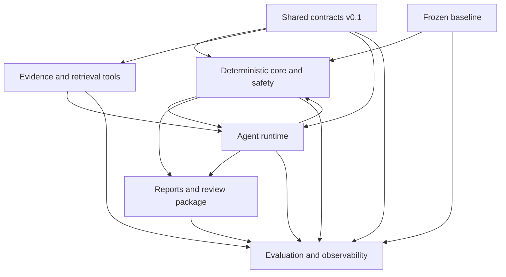

# Team Development Guide

This document is the operating agreement for the four-person Claim Denial Triage Agent team. It defines ownership, interfaces, integration order, version-control practices, evaluation discipline, and the conditions for calling work complete.

The assignments below are the recommended starting distribution. The team should confirm them at the kickoff meeting and update this document in the same pull request as any ownership change.

## Shared objective

Extend the frozen deterministic baseline with a bounded, auditable agent that can retrieve relevant evidence, compare policy criteria with synthetic encounter records, produce a cited recommendation, and prepare a grounded appeal draft when justified.

The extension must resolve more evidence-dependent cases without weakening deterministic behavior or introducing critical safety errors.

## Non-negotiable project boundaries

- `baseline/` is the comparison system and is frozen at the `baseline-v1` tag.
- All records are synthetic. No real patient or provider data may enter the repository, issues, prompts, traces, or screenshots.
- The system cannot submit claims, appeals, patient bills, or other external actions.
- Deadline calculations, disposition validation, citation resolution, and approval state remain deterministic.
- Missing, conflicting, inapplicable, or unsupported evidence results in `MANUAL_REVIEW`.
- Every report starts as `PENDING_REVIEW` and requires a human decision.
- Held-out results may not be used to tune prompts, tools, schemas, or thresholds.

## Proposed work distribution

| Workstream | Proposed primary owner | Required reviewer | Primary responsibility |
|---|---|---|---|
| Deterministic core and safety | Neha Kashyap | Sachin Kothandaraman | Baseline adapter, deadlines, validators, permitted dispositions, approval states, report safety |
| Evidence and retrieval tools | Silas Sangmin | Hriday Pradhan | Tool dispatcher, policy retrieval, encounter and eligibility tools, citations and provenance |
| Agent runtime and LLM workflow | Hriday Pradhan | Neha Kashyap | State, planning loop, model adapter, tool calling, budgets, structured decisions, verifier and drafting stages |
| Evaluation and observability | Sachin Kothandaraman | Silas Sangmin | Synthetic cases, labels, splits, metrics, fault injection, traces, result analysis, stakeholder-review package |

Primary ownership means coordinating design and merging work in that area. It does not mean working alone. The reviewer should understand the component well enough to maintain it temporarily.

## Folder ownership

| Path | Primary workstream | Collaboration rule |
|---|---|---|
| `baseline/` | Shared, read-only | No edits without a documented team decision and a new baseline version |
| `src/claim_agent/contracts/` | Deterministic core and safety | All four owners approve breaking contract changes |
| `src/claim_agent/tools/` | Evidence and retrieval | Agent owner reviews dispatcher-facing changes |
| `src/claim_agent/agent/` | Agent runtime | Safety owner reviews final-decision and retry behavior |
| `src/claim_agent/safety/` | Deterministic core and safety | Agent and evaluation owners review behavior changes |
| `src/claim_agent/output/` | Deterministic core and safety | Agent owner reviews evidence and appeal inputs |
| `knowledge/` | Evidence and retrieval | Evaluation owner reviews provenance and frozen snapshots |
| `datasets/` | Evaluation and observability | Two independent labelers approve held-out labels |
| `evaluation/` | Evaluation and observability | Component owner reviews every metric concerning their component |
| `tests/<component>/` | Matching component owner | Tests must accompany behavior changes |
| `tests/integration/` | Shared | At least two workstreams review cross-component scenarios |
| `docs/decisions/` | Shared | Decision author writes; affected owners approve |

Do not make opportunistic edits in another owner’s folder while implementing an unrelated feature. Open an issue or a small prerequisite pull request instead.

## How the four parts connect



The runtime never reads another component’s internal objects directly. Components communicate only through versioned contracts.

### Deterministic core and safety provides

- Validated baseline findings.
- Deterministic routing between rule-resolvable and evidence-dependent findings.
- Deadline calculations and expiration state.
- Structural and semantic validation results.
- Approval status and final review-package constraints.

### Evidence and retrieval provides

- A validated tool dispatcher.
- `ToolResult` records with status, data, source identifiers, and error codes.
- Versioned and citable evidence passages.
- Explicit no-match, unavailable, and incompatible-policy responses.

### Agent runtime provides

- An `AgentDecision` matching the shared schema.
- Criterion-level assessments with citations.
- Missing-evidence and escalation reasons.
- Trace events for every model turn, tool request, observation, repair, and terminal state.
- A draft request only after the evidence supports appeal eligibility.

### Evaluation and observability provides

- Frozen development and held-out manifests.
- Pre-run gold labels and annotation guidance.
- Baseline-versus-agent comparison reports.
- Fault-injection scenarios.
- Category-specific errors, confusion matrices, safety counts, latency, token, and cost summaries.

## Shared contracts version 0.1

The first implementation milestone is agreeing on these contracts:

| Contract | Purpose |
|---|---|
| `ClaimInput` | Validated claim and available-document inventory |
| `BaselineFinding` | Rule-based finding produced before agent routing |
| `EvidencePassage` | Versioned, citable policy or encounter passage |
| `CriterionAssessment` | `SUPPORTED`, `NOT_MET`, `UNKNOWN`, or `CONFLICTING` result |
| `ToolRequest` | Allowlisted tool name and validated arguments |
| `ToolResult` | Status, typed data, source IDs, and error code |
| `AgentDecision` | Disposition, actions, evidence gaps, rationale, and citations |
| `TraceEvent` | Append-only execution event with sequence and provenance |
| `ReviewPackage` | Final validated report state presented for human review |

Contract rules:

1. Enums and field names are not duplicated across components.
2. Unknown and missing values must be represented explicitly, not as guessed defaults.
3. Every persisted contract includes a schema version.
4. Every citation points to a stable passage ID in the frozen knowledge snapshot.
5. Breaking changes require an architecture decision record and approval from all affected owners.
6. Contract tests merge before implementations that consume the new contract.

## Integration strategy

Integration proceeds through one offline vertical slice before any real model API or full policy corpus is introduced:

```text
synthetic claim
  -> baseline adapter
  -> deterministic router
  -> scripted fake model
  -> fake tool dispatcher
  -> safety validator
  -> PENDING_REVIEW report
  -> JSON trace
```

The vertical slice is complete when:

- Rule-resolvable cases bypass the model.
- Evidence-dependent cases enter the fake planning loop.
- Tool arguments and results validate against shared contracts.
- Tool calls and source IDs appear in the trace.
- Invalid citations fail validation.
- Budget exhaustion produces `MANUAL_REVIEW`.
- No test requires a network connection or API key.
- Baseline regression tests still pass.

After that slice passes, replace one fake boundary at a time: real tool implementations first, then the hosted-model adapter, then verification and drafting calls.

## Merge order

Use this dependency order to avoid blocked or conflicting branches:

1. Contract definitions and contract tests.
2. Baseline adapter and deterministic router.
3. Fake model and fake tool dispatcher.
4. Offline vertical-slice integration test.
5. Real denial-code, payer-profile, and deadline tools.
6. Policy, encounter, and eligibility retrieval.
7. Bounded agent runtime and trace logging.
8. Deterministic output validation.
9. Tool-less evidence verification.
10. Grounded appeal drafting and assertion checking.
11. Development dataset and evaluation harness.
12. Frozen held-out evaluation and stakeholder review.

Later work may begin behind fake interfaces, but it must not merge before its prerequisite contract is stable.

## Phased plan

### Phase 0 — Repository and baseline

Status: complete.

- Import and preserve the stakeholder baseline.
- Verify all nine baseline tests.
- Reproduce the fixed-date example.
- Tag the comparison system as `baseline-v1`.
- Create the project folder skeleton.

### Phase 1 — Contracts and offline skeleton

- Select the agent-side schema library and document the decision.
- Define contract version `0.1`.
- Add contract validation and serialization tests.
- Implement the baseline adapter and routing boundary.
- Complete the fake-model vertical slice.

### Phase 2 — Tools and knowledge

- Implement the common dispatcher.
- Wrap denial-code, payer-profile, and deadline behavior.
- Select a small initial payer/procedure policy set.
- Add stable policy and passage identifiers.
- Add synthetic encounter and eligibility fixtures.
- Test success, no-match, missing, incompatible, malformed, and transient-error responses.

### Phase 3 — Agent runtime

- Implement provider-independent model and fake-model interfaces.
- Implement state initialization and deterministic state updates.
- Enforce planning-turn and tool-call budgets.
- Validate every model action before dispatch.
- Add one bounded repair for invalid structured output or transient failure.
- Emit append-only traces.

### Phase 4 — Verification, drafting, and human review

- Evaluate policy AND/OR criteria from criterion assessments.
- Verify evidence support in a separate tool-less call.
- Reject unresolved citations and inapplicable policies.
- Draft only evidence-supported appeals.
- Check drafts for unsupported assertions.
- Render the review package as `PENDING_REVIEW`.

### Phase 5 — Evaluation

- Keep the original six cases as development and regression cases.
- Create at least 20 additional development cases.
- Create at least 80 held-out cases.
- Keep scenario-template variants and counterfactual pairs in the same split.
- Freeze model, prompt, parameters, tool budget, and knowledge snapshot.
- Run the baseline once and the agent three times per held-out case.
- Report performance, consistency, cost, latency, and safety failures.

### Phase 6 — Stakeholder and final deliverables

- Randomize representative review packages.
- Collect stakeholder ratings and comments.
- Perform error analysis by decision type.
- Document limitations and unresolved risks.
- Produce the demonstration, final report, and reproducibility instructions.

## Dataset and labeling protocol

1. Write the annotation rubric before producing system outputs.
2. Assign two independent labelers to every held-out case.
3. Resolve disagreements before either labeler reviews agent output.
4. Record the correct root cause, disposition, actions, deadline, evidence requirements, criterion states, appeal eligibility, and expected escalation reason.
5. Keep counterfactual pairs in the same dataset split.
6. Freeze the split manifest and labels before final evaluation.
7. Never tune against held-out failures. Record them for final analysis.
8. Use only synthetic records and appropriately attributed policy excerpts.

## Git and GitHub workflow

`main` should remain protected and releasable.

### Start work

1. Fetch and pull `main` in GitHub Desktop.
2. Create a short-lived branch from the updated `main`.
3. Link the branch or pull request to one GitHub issue.
4. Confirm the issue’s acceptance criteria before coding.

Recommended branch patterns:

```text
feat/contracts-v01
feat/baseline-adapter
feat/policy-retrieval
feat/agent-runtime
feat/safety-validation
test/agent-budget-failures
eval/joint-decision-metrics
docs/adr-model-provider
```

### Commit and review

- Keep commits focused on one logical change.
- Do not combine schema, dataset, runtime, and documentation rewrites in one commit.
- Keep branches short; aim to merge within two or three working days.
- Pull or merge the latest `main` before requesting final review.
- Use the primary owner and required reviewer from the work-distribution table.
- Require a second cross-workstream reviewer for shared contracts and integration tests.
- Delete the branch after merge.

Suggested commit prefixes:

```text
feat: user-visible capability
fix: behavior correction
test: test-only change
eval: dataset or evaluation change
docs: documentation or ADR
refactor: behavior-preserving code change
chore: repository or tooling maintenance
```

## Pull request checklist

- [ ] The pull request has one clear purpose and links its issue.
- [ ] The implementation stays within the assigned ownership boundary.
- [ ] Shared contract changes are documented and versioned.
- [ ] New behavior has focused tests.
- [ ] Baseline regression tests still pass.
- [ ] Offline integration tests pass without a model key.
- [ ] Failure, missing-data, and manual-review paths are tested.
- [ ] No secrets, real patient data, generated traces, or local outputs are included.
- [ ] Documentation reflects any changed command, contract, or behavior.
- [ ] The required component owner reviewed the change.

## Definition of done

A task is not done merely because code has been written. It is done when:

1. Its acceptance criteria are satisfied.
2. Focused tests pass.
3. Baseline regression tests pass.
4. Relevant offline integration tests pass.
5. Error and escalation behavior is explicit.
6. Traces contain the necessary provenance without sensitive data.
7. Public and internal documentation is current.
8. The required reviewer approves it.
9. The branch is merged through a pull request.
10. `main` remains clean and reproducible.

## Architecture decisions

Record decisions that affect multiple workstreams under `docs/decisions/`. Use sequential names such as:

```text
0001-agent-side-schema-library.md
0002-model-provider-interface.md
0003-policy-passage-identifiers.md
0004-trace-storage-format.md
```

Each decision should state:

- Context and problem.
- Considered options.
- Chosen decision.
- Consequences and tradeoffs.
- Affected components and contracts.

Initial decisions still needed:

- Agent-side schema and validation library.
- Hosted-model provider abstraction.
- Knowledge retrieval method for the first corpus.
- Prompt and model versioning format.
- Trace schema and cost accounting.
- Development/held-out data freeze procedure.

## Communication cadence

- Hold two brief progress syncs per week.
- Hold one weekly integration demonstration using the current `main` branch.
- Each owner reports completed work, next dependency, and current blocker.
- Demonstrate behavior and tests rather than reporting only file changes.
- Record cross-team decisions in an ADR or GitHub issue, not only in chat.
- Escalate a contract disagreement before parallel implementations diverge.

## First shared backlog

Create these GitHub issues before individual implementation begins:

1. Decide the agent-side schema library.
2. Define contract version `0.1`.
3. Add contract serialization and rejection tests.
4. Implement the baseline adapter.
5. Implement deterministic rule/evidence routing.
6. Implement a scripted fake model.
7. Implement a fake dispatcher with provenance IDs.
8. Add the offline vertical-slice integration test.
9. Select the initial payer/procedure policy subset.
10. Draft the dataset annotation rubric.

Only after issues 1–8 merge should the team begin replacing fake boundaries with real tools and hosted-model calls.
